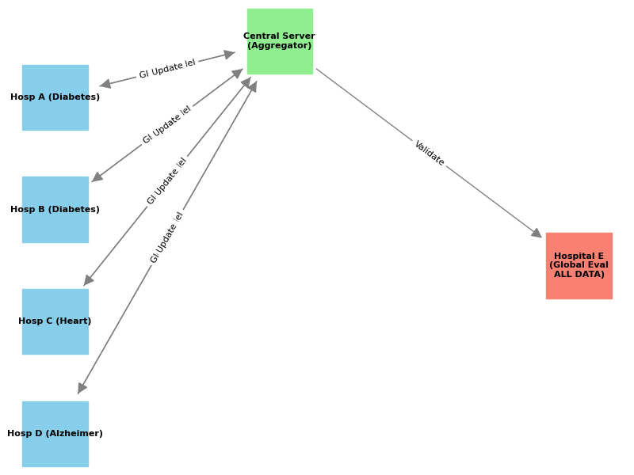
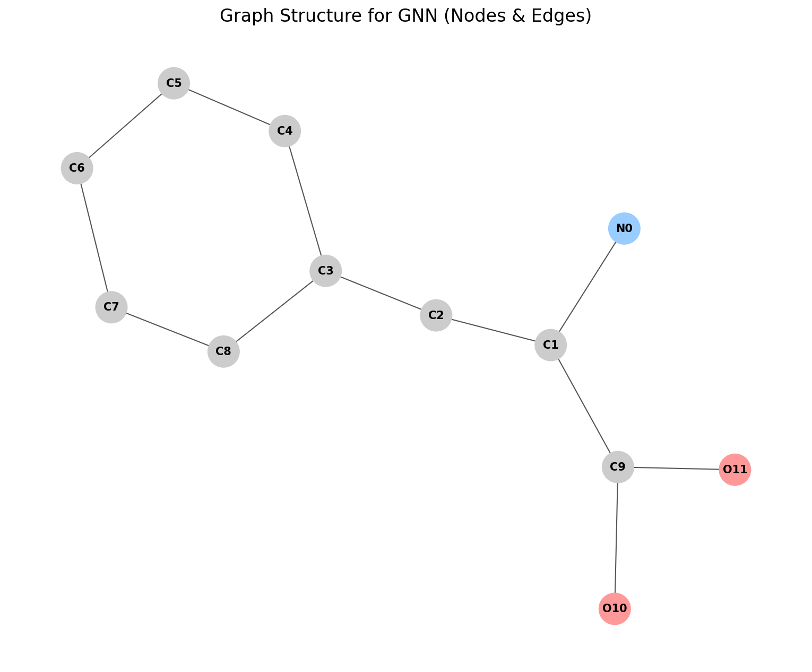
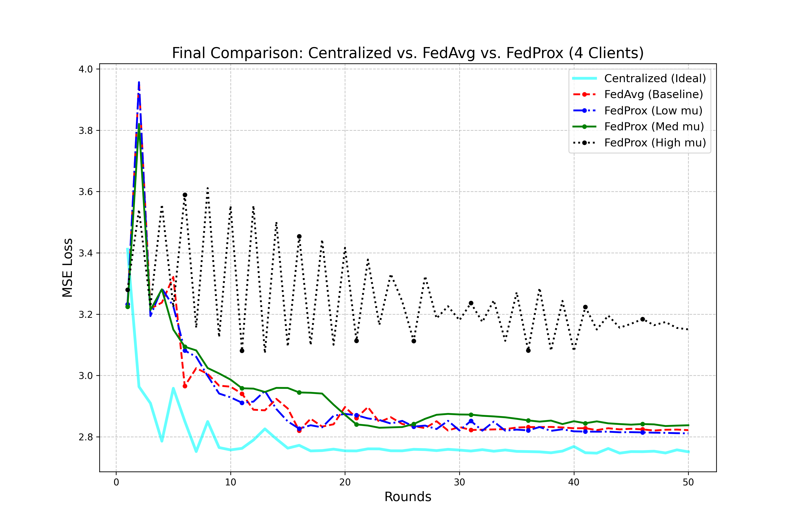
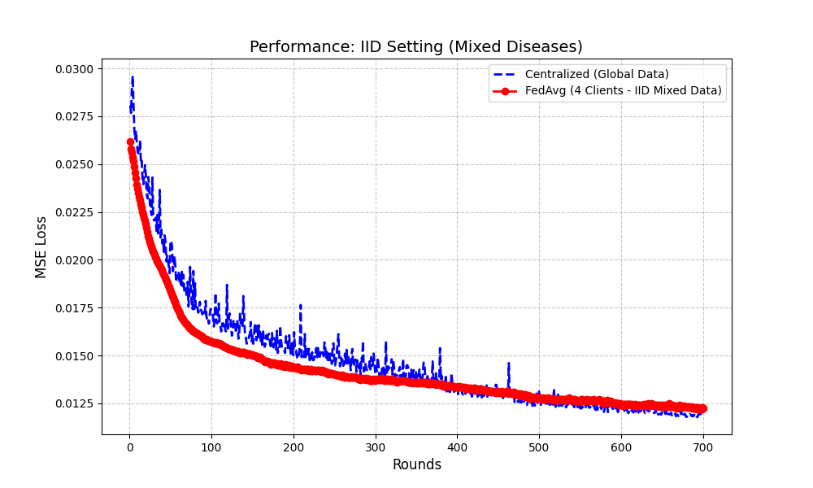
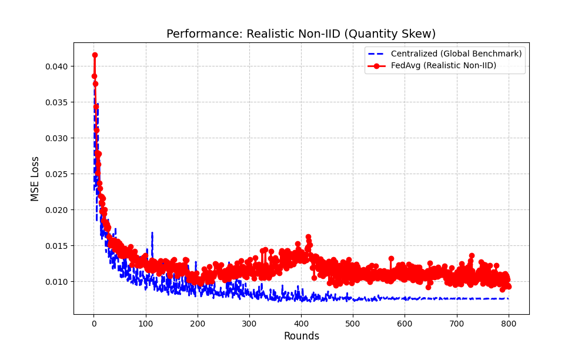
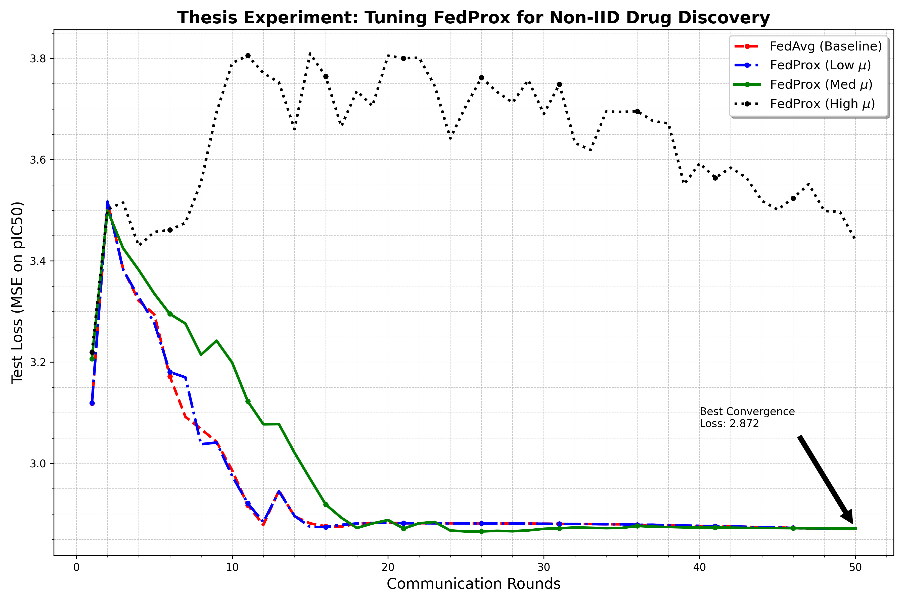

# Federated Learning for Molecular Property Prediction



This project investigates whether federated learning can predict molecular
bioactivity without centralizing the training data from participating clients.
Molecules are represented as graphs derived from SMILES strings, and the target
is the logarithmic potency value (pIC50).

## Project at a glance

Organizations may want to learn from related molecular bioactivity data without
sharing raw measurements or molecular records. Each client trains locally,
sends model updates to a coordinating server, and receives the aggregated
global model.

```text
SMILES
  -> RDKit molecular graph (atom features + bond features)
  -> GATv2 graph neural network
  -> local pIC50 regression at each client
  -> weighted FedAvg aggregation
  -> updated global model
```

### Molecular representation

Each molecule is converted into a graph where atoms are nodes and chemical
bonds are edges. Node features include atomic number, formal charge, degree,
aromaticity, atomic mass, hydrogen count, and hybridization. Bond features
include bond order, conjugation, and ring membership.



## Research summary

- **Task:** Regression of molecular pIC50 values for drug-discovery datasets
  associated with diabetes, heart disease, and Alzheimer's disease.
- **Model:** A graph neural network using GATv2 attention layers, layer
  normalization, residual connections, and mean/max graph pooling.
- **Federated setup:** Flower coordinates multiple clients. FedAvg is used as
  the aggregation baseline, and the client training loop also supports the
  FedProx proximal term.
- **Experimental settings:** The scripts compare centralized training with
  federated training under separated disease distributions, IID partitions,
  and realistic non-IID quantity-skew partitions.
- **Evaluation:** Mean squared error (MSE), mean absolute error (MAE), and
  R2 are calculated on a shared validation/test split.
- **Hyperparameter search:** Optuna explores hidden dimension, attention heads,
  number of layers, dropout, learning rate, and weight decay.

The experiments are intended to study privacy-preserving training behavior and
model performance. The results are not clinical evidence and must not be used
for diagnosis, treatment, or drug-safety decisions.

## Experimental design

The report evaluates a centralized GATv2 model as an upper-bound benchmark and
compares it with federated models under increasingly difficult distributions:

1. **Extreme Non-IID:** clients specialize in different disease groups.
2. **IID / balanced:** mixed disease data is distributed more evenly.
3. **Quantity-skew Non-IID:** clients have different amounts of data.
4. **FedProx comparison:** several proximal-strength settings are compared
   with the FedAvg baseline.
5. **5-fold validation:** repeated partitions examine stability under
   imbalanced data.

The communication loop follows the report's design: the server broadcasts
global weights, clients train locally with MSE loss, clients return updated
weights and sample counts, and the server computes a sample-weighted FedAvg
update. Raw molecular graphs and pIC50 labels remain local to each client in
the intended deployment model.

## Results from the accompanying report

The report's centralized benchmark achieved **MSE 0.739** and **R2 0.704** on
the shared test set. Federated training generally converged toward the
centralized benchmark, with the smallest gap in the balanced/IID setting.
Extreme Non-IID and quantity-skew settings introduced more fluctuation and a
larger performance gap, but the global model still converged. Across the
reported 5-fold validation runs, final MSE values were 1.000, 1.028, 1.043,
1.060, and 0.925, for an average of **1.011**.

These figures explain the research behavior, not clinical performance. Exact
values can differ because of data partitions, random seeds, package versions,
hardware, and experiment configuration.

### Convergence and FedProx behavior



FedAvg and low/medium FedProx settings approach the same lower-loss region,
while an overly strong proximal term can impede optimization. The useful
FedProx value is therefore data- and hyperparameter-dependent.

### Balanced/IID and quantity-skew settings





The balanced setting produces smoother convergence and a smaller gap to
centralized training. Quantity skew causes more variation, but weighted
aggregation remains stable and continues to reduce global loss.

### Overall tuning view



## Repository layout

- `FedProj/dataset.py` converts SMILES strings into PyTorch Geometric graphs.
- `FedProj/model.py` defines the GATv2 molecular graph model.
- `FedProj/client.py` implements local training, evaluation, and Flower client
  communication.
- `FedProj/main.py` runs the baseline federated simulation.
- `FedProj/experiment_2.py`, `experiment_3.py`, and `experiment_4.py` run
  centralized/federated comparison experiments.
- `FedProj/evaluation.py` calculates comparison metrics and creates plots.
- `FedProj/tune_model.py` runs Optuna hyperparameter tuning.

## Important scope note

The accompanying report describes experiments involving four disease groups
and 11,936 molecular records. The public source snapshot currently contains
client examples for three disease CSVs (`diabetes`, `heart`, and `alzheimers`).
The fourth-group data and all raw records are intentionally not published
here, so the report's full numerical results cannot be reproduced from this
public repository alone.

## Data and generated artifacts

The public repository intentionally excludes raw CSV datasets, processed
PyTorch datasets, trained model weights, logs, caches, and most generated
figures. The small set of curated figures above is included only to document
the project and its reported behavior. Raw and derived data should be stored
separately with appropriate access controls. To run the scripts, provide the
required local datasets under `FedProj/raw/` and use the file names expected
by the selected experiment.

The privacy claim is architectural: the intended federated loop exchanges
model parameters rather than raw molecular records. Production deployment
would still require secure transport, authentication, access control, and
additional protections against model-update leakage.

## Reproducibility notes

The scripts use PyTorch, PyTorch Geometric, RDKit, Flower, scikit-learn,
Optuna, pandas, NumPy, matplotlib, seaborn, and Ray. Exact results depend on
package versions, hardware, random seeds, data split, and Flower/Ray
configuration. Record those details alongside any future reported results.
